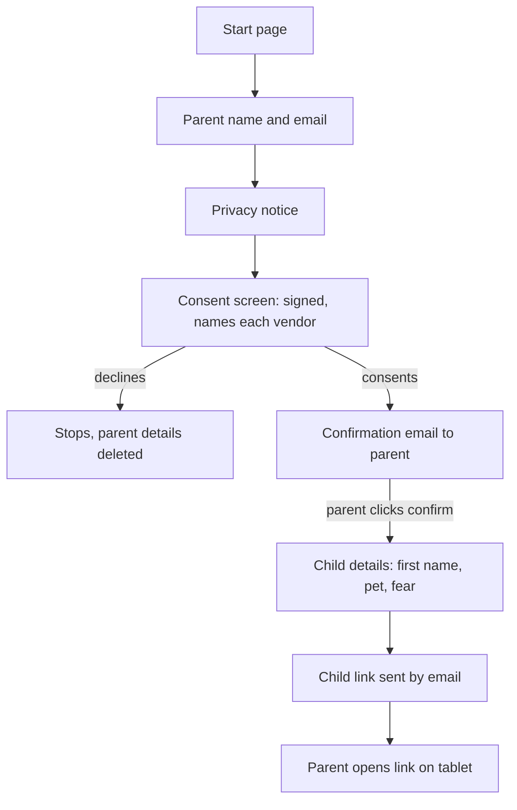
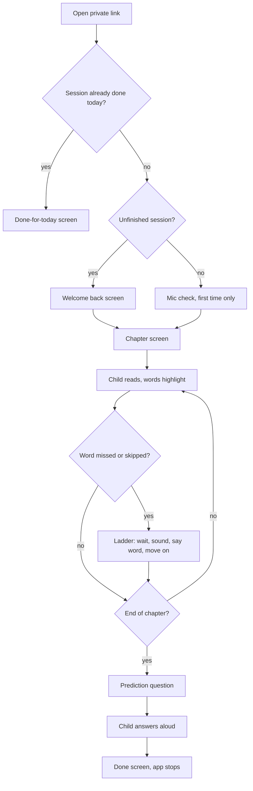
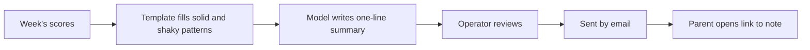

# Primer MVP: UX Flows and Screens

2026-10-09 · Nishi · Status: draft, decisions resolved · Builds on [02-prd.md](02-prd.md)

Screens are ASCII sketches for an iPad in landscape. They show layout and states, not final visuals. Design decisions UX1 to UX4 were settled on 2026-10-09 and UX5 to UX8 (consent and data controls) later; all are listed at the end.

## Flow 1: Parent signup and consent

Nothing about the child is collected until the parent's consent is recorded and confirmed. Only the parent's own name and email come first.



## Flow 2: Daily session



## Flow 3: Weekly note



## Screens

### S1. Mic check (first session only)

```
+--------------------------------------------------+
|                                                  |
|        Let's check that I can hear you!          |
|                                                  |
|            [  ( mic icon )  ]                    |
|                                                  |
|        Say: "Hello"                              |
|                                                  |
|        (level bar  ||||||||        )             |
|                                                  |
+--------------------------------------------------+
```

Safari asks for microphone permission here. If denied, see E1.

### S2. Chapter, ready

```
+--------------------------------------------------+
|  Chapter 3                                       |
|                                                  |
|    Sam ran to the pond.                          |
|    Fig sat on a log. Fig sat and sat.            |
|    "Sit, Sam," said Fig.                         |
|                                                  |
|                                                  |
|                  [ Start reading ]               |
+--------------------------------------------------+
```

Large type, about 4 to 6 short lines, no scrolling for 60 to 120 words. The microphone goes live only when the child taps Start.

### S3. Chapter, reading

```
+--------------------------------------------------+
|  Chapter 3                          ( listening )|
|                                                  |
|    [Sam] [ran] [to] the pond.                    |
|     ^done, soft highlight  ^current underlined   |
|                                                  |
+--------------------------------------------------+
```

Word states: not yet read (plain), current (underline), read (soft highlight). A missed word is never marked red or labeled wrong.

### S4. Hint ladder on a missed word

```
Rung 1: wait (3s)          Rung 2: show sound (3s)      Rung 3: say word
 Sam ran to the [pond]      Sam ran to the [p-o-n-d]     Sam ran to the pond
  word pulses gently         sound shown under letters    app says "pond", then
                                                          moves to the next word
```

The same sequence every time. Nothing is said about being wrong. After rung 3 the reader moves on and the child does not repeat the word.

### S5. Prediction question

```
+--------------------------------------------------+
|                                                  |
|     What do you think happens next?              |
|                                                  |
|            [  ( mic icon )  ]                    |
|            Tap and tell me                       |
|                                                  |
+--------------------------------------------------+
```

The child taps the mic button to start and taps it again to stop.

### S6. Done screen

```
+--------------------------------------------------+
|                                                  |
|           You finished today's story!            |
|                                                  |
|              See you tomorrow.                   |
|                                                  |
+--------------------------------------------------+
```

No buttons, scores, streaks or rewards. The app does nothing further. Reloading shows S7.

### S7. Done for today (second start blocked)

```
+--------------------------------------------------+
|                                                  |
|        You already read today.                   |
|        Come back tomorrow for the next chapter.  |
|                                                  |
+--------------------------------------------------+
```

### S8. Welcome back (interrupted session)

```
+--------------------------------------------------+
|                                                  |
|            Welcome back!                         |
|            Let's keep reading.                   |
|                                                  |
|                  [ Continue ]                    |
+--------------------------------------------------+
```

Resumes at the last word reached.

### S9. Signup step 1: parent details (parent-facing)

```
+--------------------------------------------------+
|  Set up Primer for your child                    |
|                                                  |
|  This is a four-week reading study with          |
|  ten families.                                   |
|                                                  |
|  Your name            [_____________]            |
|  Your email           [_____________]            |
|                                                  |
|  We don't ask about your child until you've      |
|  read and agreed to how we handle their data.    |
|                                                  |
|                         [ Continue ]             |
+--------------------------------------------------+
```

### S9a. Privacy notice

Draft wording for the legal reviewer. Plain language, one screen, no scrolling box.

```
+--------------------------------------------------+
|  How we handle your child's information          |
|                                                  |
|  What we collect                                 |
|   Your child's first name, a pet's name and      |
|   something they fear (used in the story),       |
|   recordings of them reading and answering,      |
|   the words they read right or wrong, and        |
|   your email.                                    |
|                                                  |
|  Who handles it                                  |
|   Deepgram   turns the recordings into words     |
|   Supabase   stores the records                  |
|   Resend     sends you emails                    |
|                                                  |
|  What happens to recordings                      |
|   Deleted right after scoring, unless you        |
|   choose to let us keep them.                    |
|                                                  |
|  How long we keep the rest                       |
|   Until 90 days after the study ends, then       |
|   deleted. Backups clear within 14 days of a     |
|   deletion.                                      |
|                                                  |
|  Your choices                                    |
|   See, change or delete everything, or stop      |
|   keeping recordings, at any time.               |
|                                                  |
|  Questions: <contact email>                      |
|                                                  |
|                         [ Continue ]             |
+--------------------------------------------------+
```

We never use the information for advertising, and we do not share it with anyone beyond the three services above. (Statement to confirm with the legal reviewer.)

### S9b. Consent screen

```
+--------------------------------------------------+
|  Your consent                                    |
|                                                  |
|  I am the parent or legal guardian of the child  |
|  who will use Primer.                            |
|                                                  |
|  [ ] I have read the privacy notice and agree    |
|      to Primer collecting my child's name,       |
|      story details, voice and reading scores,    |
|      and sharing them with Deepgram, Supabase   |
|      and Resend as described.                   |
|                                                  |
|  Optional:                                       |
|  [ ] Keep recordings of my child's reading       |
|      (otherwise deleted right after scoring)     |
|                                                  |
|  Type your full name to sign                     |
|  [______________________]   Date: <today>     |
|                                                  |
|     [ I don't agree ]          [ I agree ]       |
+--------------------------------------------------+
```

Nothing is stored about the child at this point. "I agree" records the consent version, the vendor list, the typed name, and a timestamp. The audio box is unchecked by default and is separate from the required box.

### S9c. Check your email

```
+--------------------------------------------------+
|  Check your email                                |
|                                                  |
|  We sent a message to <email>.                   |
|  Click the link in it to confirm it was you.     |
|  It includes a copy of what you agreed to.       |
|                                                  |
|  Didn't get it?  [ Send again ]                  |
+--------------------------------------------------+
```

### S9d. Signup step 2: child details (after the confirmation link)

```
+--------------------------------------------------+
|  Tell us about your child                        |
|                                                  |
|  Child's first name   [_____________]            |
|  A pet's name         [_____________]            |
|  Something they fear  [_____________]            |
|                                                  |
|  These appear in the story. You can't change     |
|  them later. (To change, email <contact email>.) |
|                                                  |
|                         [ Finish ]               |
+--------------------------------------------------+
```

The prompts are fixed: a pet's name and something the child fears. Each has a known slot in the chapters. Finishing emails the child's private link.

### S9e. Manage my child's data (parent, link in every email)

```
+--------------------------------------------------+
|  Manage <child>'s data                           |
|                                                  |
|  Recordings:  [ Not kept ]  or  [ Kept ]         |
|     [ Stop keeping recordings and delete them ]  |
|                                                  |
|  [ Download everything we have ]                 |
|                                                  |
|  [ Delete everything and leave the study ]       |
|     (asks "Are you sure?" first)                 |
+--------------------------------------------------+
```

Uses its own private token, separate from the child's link. Deleting everything removes the child's records and the parent's contact details. Scores already used in the study results can't be pulled back out once the results are published; the notice should say so if the legal reviewer asks for it.

### S10. Weekly parent note

```
Subject: Sam's reading this week

Sam read 4 chapters. A quick summary: <one line from the model>

Solid:   short a, short i, "th"
Shaky:   "ck" endings, "sh"

Tonight, read together: the pond scene
  <link to page excerpt>

What Sam thinks happens next:
 - Ch 1: "Fig will find a bone"
 - Ch 2: "Maybe Sam gets lost"
 - ...
```

Plain text, readable as an email. The note stays short; the page to read together opens from a link as a web page the parent can read on the tablet or print.

### S11. Excerpt page (parent, opened from the note)

```
+--------------------------------------------------+
|  Read this together tonight                      |
|                                                  |
|    Sam ran to the pond.                          |
|    Fig sat on a log. Fig sat and sat.            |
|                                                  |
|        [ We read it together ]                   |
+--------------------------------------------------+
```

Opened by the note's excerpt link, which has its own token. Opening it sets `opened_at`; tapping the button sets `page_read_at`. Printable.

## Error and edge states

| # | Situation | Behavior |
| --- | --- | --- |
| E1 | Microphone denied | Screen tells the parent how to enable it in Safari settings; the child cannot start until it works. |
| E2 | Child is silent for a long time | The ladder runs on the current word; if the whole chapter stalls, the session pauses and shows S8 next time. |
| E3 | Loud background noise | Scoring still runs; the noisy session is flagged for the operator, with nothing shown to the child. |
| E4 | Connection drops | The reading continues locally; the session is saved when the connection returns, or resumes from S8. |
| E5 | Invalid or expired link | Plain page: "This link does not work. Ask your parent." |
| E6 | Tablet rotated or app backgrounded | Treated as an interruption; resumes from the last word. |

## Design decisions

| # | Decision |
| --- | --- |
| UX1 | Child taps Start; the microphone is not live before that |
| UX2 | Child taps to start and taps to stop the prediction answer |
| UX3 | Fixed prompts: pet's name and a fear |
| UX4 | Short inline note plus a link to the page excerpt |
| UX5 | Parent first; child details only after consent is confirmed by email (2026-10-12) |
| UX6 | Consent is a typed full name, a required checkbox and an email confirmation; legal review may strengthen it |
| UX7 | Keeping recordings is a separate unchecked box on the consent screen |
| UX8 | Parents manage and delete data on a self-service page with its own token (S9e) |

## Follow-ups for later documents

- **Legal review:** the privacy notice (S9a) and consent wording (S9b) are drafts for the reviewer. Items flagged for them: the "no advertising, no sharing beyond the three services" statement, and whether published study results can keep scores after a parent deletes their data.
- **Data model:** Family needs parent_name, typed_signature, consent_confirmed_at and a manage_token. Child rows are created only after confirmation.
- **Technical design:** confirmation email, manage page and deletion job (including vendor-side deletion) need a design.

- **Data model:** done. Excerpt entity and `opened_at` / `page_read_at` are in [04-data-model.md](04-data-model.md); screen S11 above covers the excerpt page.
- **Technical design:** the excerpt link needs the same private-token protection as the child's link.
- **Content:** a fear detail appears in the story, so chapter slots and the human review need to keep the fear from being frightening.
