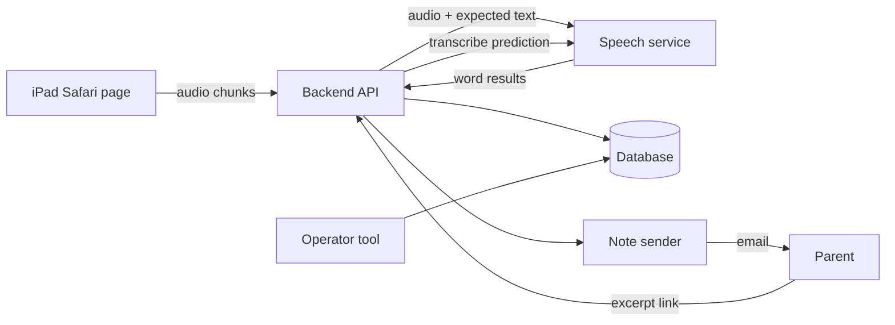

# Primer MVP: Technical Design

2026-10-09 · Nishi · Status: draft, choices made · Builds on [02-prd.md](02-prd.md), [03-ux-flows.md](03-ux-flows.md) and [04-data-model.md](04-data-model.md)

Each choice section lists options, then records the decision made on 2026-10-09 (TD1 to TD6, summarized at the end). Vendor features and prices below come from general knowledge and must be checked before committing.

## Goals and constraints

- One person builds it in about two weeks.
- iPad with Safari only. Microphone capture in Safari is the main browser risk.
- Ten families, so scale does not matter; simplicity and cost visibility do.
- Children's voices and names are involved, so privacy choices are conservative by default.

## Architecture

Data flow for one session: the page loads a chapter for the child's token, records the microphone, and streams audio to the backend. The backend streams it to the speech service, which returns word timings as the child reads; the backend matches them against the known chapter text and returns word outcomes, which the page uses to highlight words and run the hint ladder. Live highlighting and the ladder timers require **streaming** recognition, not recorded-file transcription. Outcomes are saved as WordAttempt rows. Audio is deleted after scoring unless the family opted in.

## Fixed by the MVP (no choice needed)

| Area | Design |
| --- | --- |
| Curriculum | Plain table in code listing 16 patterns in order, with sight words per step. The model never chooses the lesson. |
| Chapters | Drafted once by a language model, filtered by the decodability script, then read by a human. Stored as templates with slots for pet name and fear. |
| Decodability script | Runs over every sentence; rejects any word using an untaught pattern or non-listed sight word. |
| Parent note | Template fills solid and shaky patterns from scores; the model writes only the one-line summary; the operator reviews before sending. |
| Access | No logins. Each child has a private token link, and each note has its own excerpt token. |
| Language and device | English, iPad Safari. |

## Choice 1: Front end

The page shows text, records the microphone, highlights words and runs the ladder timers.

| Option | Pros | Cons |
| --- | --- | --- |
| A. Plain HTML + vanilla JS | Nothing to build or update; fewest moving parts for a single screen flow | State handling gets hand-rolled; messier as screens grow |
| B. Small framework (React or similar) with Vite | Familiar component model; easy to build the many screen states | A build step; more to learn if unfamiliar |
| C. Server-rendered pages with a little JS | Simple deploy; signup and note pages come free | Real-time highlighting still needs JS anyway |

Recommendation: **B**, because the reading screen has several states (ready, listening, ladder rungs, done, resume) and benefits from components. Choose A if you want zero tooling.

**Decision (TD1): B**, a small framework with Vite.

## Choice 2: Speech scoring

The expected text is known, so the job is matching timings to words. This decision matters most: the whole first research question rests on it.

| Option | Pros | Cons |
| --- | --- | --- |
| A. General speech-to-text with word timings (such as Deepgram, AssemblyAI, Google, OpenAI) | Cheap, easy streaming; you align returned words to the chapter yourself | Models tend to correct mispronunciations into the "right" word, which hides errors; children's speech accuracy varies |
| B. Pronunciation-assessment service that takes reference text (such as Azure Speech pronunciation assessment) | Built for this: per-word scores against reference text | Scores are tuned for language learners, and quality on 5 to 7 year olds is unproven; cloud-vendor setup |
| C. Open-source model (such as Whisper) run on your own server | Full control and word timestamps; no per-minute vendor cost | You host and tune it; slower; the same autocorrect problem as A |

Recommendation: start with **A**, aligned to the chapter text, and measure agreement against the human listener (as the MVP plans). Keep **B** as a fallback if agreement falls short.

**Decision (TD2, revised 2026-10-12): A**, general speech-to-text aligned to the chapter text. **Vendor: Deepgram** streaming. Azure was dropped from the up-front plan: the human-listener check on the first three families already tests whether A is trustworthy, and a second speech vendor would add a third party to the consent form and legal review.

**Fallback:** if agreement with the human listener is below the Brief's threshold (90% of words, no group clearly worse), integrate B (Azure Speech pronunciation assessment, which scores each word against reference text) and re-run the same comparison on the same recordings. Before doing so, add Azure to the consent form and legal review. What we know about B: its price is the same as standard speech-to-text per the [Microsoft docs](https://learn.microsoft.com/en-us/azure/ai-services/speech-service/how-to-pronunciation-assessment), though third-party sources quoted different figures; audio over 30 seconds needs continuous mode, which does not flag omissions or insertions, so those come from comparing to the chapter text; child-voice accuracy is unverified. Deepgram list prices ([deepgram.com/pricing](https://deepgram.com/pricing)): Nova-3 $0.0043/min recorded and a regular $0.0077/min streaming, with $200 free credit. About 160 sessions of about 2 minutes is roughly 320 minutes, so speech cost for the pilot is small.

## Choice 3: Hosting and database

| Option | Pros | Cons |
| --- | --- | --- |
| A. Single small server (one app, SQLite or Postgres) | Cheapest and simplest; one place to look; easy deletion of audio | You manage the server and backups |
| B. Backend-as-a-service (such as Supabase or Firebase) | Database, file storage and scheduled jobs included | Data sits on a third-party platform; more settings for children's data |
| C. Serverless functions plus a managed database | Little server upkeep; cheap at low use | More pieces; long audio uploads and timeouts to manage |

Recommendation was **A** for ten families. Scalability was the deciding question, since A scales least and B grows past the pilot with no extra work.

**Decision (TD3): B**, a backend-as-a-service. Consequences:
- The platform's database, file storage and scheduled jobs replace the server.
- **Vendor (2026-10-12): Supabase, free plan.** Checked against [supabase.com/pricing](https://supabase.com/pricing): 500 MB database, 1 GB file storage, 50,000 MAU, 5 GB egress. This is enough for ten families.
- The free plan **pauses a project after a week of inactivity** and **includes no automatic backups**. Mitigations: keep the project active (a daily scheduled ping or the daily sessions themselves) and wake it before launch; run a nightly export of the database to a private location you control. Revisit Pro ($25/month, 7-day daily backups) if either risk bites, or before holding data from any family you cannot afford to lose.
- Supabase Free and Pro do not include HIPAA or SOC 2. Children's voice data is not HIPAA data, but the COPPA section below still applies.
- Children's data sits on a third-party platform, so choose a region deliberately, turn on row-level access rules and keep the storage bucket for opted-in audio private.
- Temporary audio between recording and scoring goes in a private bucket with a short expiry, plus a scheduled job that deletes anything older than the scoring window.

## Choice 4: Note and link delivery

The PRD (Q6) originally let parents choose text or email. On 2026-10-12 this was narrowed to email only for now.

| Option | Pros | Cons |
| --- | --- | --- |
| A. Email provider plus an SMS provider, both through scripts | Matches the PRD; automated | Two vendors; SMS needs phone consent and sender registration, which can take time |
| B. Email through a script, SMS sent by hand by the operator | No SMS vendor or registration for ten families | Manual, and the operator's own phone number is in use |
| C. Both sent by hand | Zero integration | Easy to forget; harder to log sent_at and opens |

Recommendation was **B**, to avoid SMS registration delays.

**Decision (TD4, revised 2026-10-12): email only, through Resend, sent by script.** SMS is deferred. Supersedes the earlier choice of email and SMS both by script. Consequences:
- **Vendor:** Resend. Its free tier reported by secondary sources (3,000 emails a month, 100 a day, one verified domain) covers ten families; confirm on resend.com/pricing.
- The signup form and the PRD drop the text option. Parents without email cannot join the pilot.
- No SMS registration, phone consent or SMS vendor are needed now. If SMS returns, Twilio sole-proprietor registration was the option researched ($4 brand, $15 campaign, $2/month; approval time unconfirmed and can take days to weeks).
- Each send writes sent_at; link clicks write opened_at.
- Keep manual sending as a fallback if registration is not ready for the first families.

## Choice 5: Prediction answer transcription

The PRD requires a text transcript of the child's answer, with the clip deleted afterward.

| Option | Pros | Cons |
| --- | --- | --- |
| A. Same speech service as Choice 2 | One vendor; one cost line | Free speech quality for a child may be rough |
| B. A separate stronger transcription model | Possibly better for open speech | Second vendor and second cost line |
| C. Operator transcribes by hand for week 1 families, then switch | Highest accuracy at first | Not automatic |

Recommendation: **A**, and treat transcripts as approximate in the note ("what Sam seems to say").

**Decision (TD5): A**, the same speech service as scoring.

## Privacy and data handling

- Audio is held only in temporary storage between recording and scoring, then deleted. Families with keep_audio true have audio stored separately.
- Connections use HTTPS only. Tokens are long and random. A missing or wrong token returns the same plain error page.
- Audio sent to a speech vendor should use settings that do not retain or train on it, where the vendor offers that. Verify per vendor.
- A parent consent screen at signup states what is kept and for how long. The PRD defers retention periods to this document: **proposal** is to delete scores, transcripts and contact details a set number of days after the pilot ends. **Decision (TD6): 90 days** after the pilot ends, then delete scores, transcripts and parent contact details. The PRD's audio opt-in can be revoked by the parent at any time, which deletes stored audio immediately.
- **COPPA applies, so plan for it.** The amended rule ([Federal Register, 2025-04-22](https://www.federalregister.gov/documents/2025/04/22/2025-05904/childrens-online-privacy-protection-rule)) covers children's voice recordings, and its compliance date was April 22, 2026. The FTC's voice-recording exception is for audio used solely as a replacement for written words and then destroyed; scoring a child's reading while also holding a name probably does not qualify, so assume verifiable parental consent is required.
- The "email plus" consent method is for data not disclosed to third parties. Sending audio to a speech vendor is a disclosure, so a checkbox or email-plus is likely not enough.
- **Decision (2026-10-12): stronger consent now, plus a legal check.** Signup uses a signed parental-consent step that names each vendor that touches the child's data (speech service, backend platform, email provider). The exact consent mechanism is chosen with the legal reviewer. No family is recruited until the review is done.
- This is research notes, not legal advice.

## Operator tools

- A minimal page or script to list sessions, play audio for the first three families, mark each word correct, wrong or skipped, and compute agreement.
- A script to compute weekly solid and shaky patterns and draft the note.
- A cost view summing CostLog by child and day.

## Measuring scoring agreement

For each reviewed word, record the app outcome (WordAttempt.outcome) and the human outcome (HumanReview.human_outcome). Agreement is the share of words where they match. Break it down by age and accent group to check that no group is clearly worse. If agreement is below the Brief's threshold, change the scoring approach before building more.

## Deployment

One deployment with HTTPS, environment variables for keys, and a daily database backup. No staging environment.

## Risks

| Risk | Mitigation |
| --- | --- |
| Safari microphone permission or audio format quirks | Test on a real iPad on day one |
| Speech service autocorrects a child's mispronunciation | Measure against the human listener; fall back to the pronunciation-assessment option if agreement is below threshold |
| Latency makes the ladder timing feel off | Keep the 3-second timings tunable; test on a real connection |
| Supabase free project paused or data lost (no backups) | Keep the project active; nightly export; move to Pro if needed |
| Consent mechanism not accepted by legal review | Recruit only after review; keep the pilot to families you know |
| Cost per child per day is too high | CostLog per call from session one |
| Child data exposure | Minimal data, 90-day retention, private storage, row-level access rules, conservative vendor settings |

## Decisions

| # | Decision |
| --- | --- |
| TD1 | Front end: small framework with Vite |
| TD2 | Speech scoring: Deepgram streaming, aligned to chapter text; Azure pronunciation assessment is a fallback only (revised 2026-10-12) |
| TD3 | Hosting and database: Supabase, free plan (pause and no-backup risks accepted, mitigated) |
| TD4 | Delivery: email only, Resend; SMS deferred (revised 2026-10-12) |
| TD5 | Prediction transcription: same service as scoring |
| TD6 | Retention: 90 days after the pilot ends |

## Follow-ups

- Add the excerpt page and its "We read it together" button as a screen in [03-ux-flows.md](03-ux-flows.md).
- Before signing up for Deepgram: confirm its data-retention and training opt-out settings and whether it will sign the written assurances COPPA expects of a service provider. Its pricing page did not say.
- Only if the fallback triggers: confirm Azure pronunciation assessment pricing and child-voice accuracy, and add Azure to the consent form and legal review first.
- Do the legal review of the consent mechanism and privacy notice before recruiting any family.
- Add a short privacy notice page and the consent screen to [03-ux-flows.md](03-ux-flows.md).
